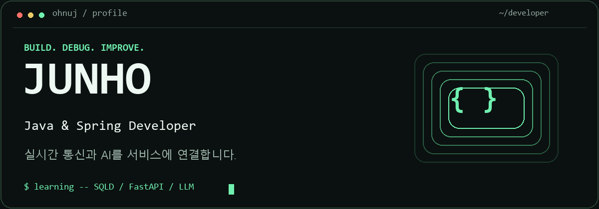

  

  <a href="#projects"><b>Projects</b></a> &nbsp; / &nbsp;
  <a href="#toolbox"><b>Toolbox</b></a> &nbsp; / &nbsp;
  <a href="https://github.com/ohnuj?tab=repositories"><b>Repositories</b></a> &nbsp; / &nbsp;
  <a href="mailto:jjh980225@gmail.com"><b>Contact</b></a>

 

<h2 id="projects">Selected Work</h2>

**실시간 채팅부터 사용자 화면, 인증·연결 복구까지 구현했습니다.**

- **채팅** — 송수신 · 참여자 · 초대 · 방장 위임 · 강퇴
- **서비스** — 영상·작품 상세·마이페이지 · 신고·알림 · 저작권 관리
- **안정화** — 인증 복구 · 반복 요청 제한 · WebSocket 연결·종료 처리

`Spring Boot` `React` `Redis` `WebSocket` `MySQL`

저장소 포크 및 시연 영상 공개 예정

 

**개인화 추천과 응답 검증, 저장 일관성·추적 로그를 구현했습니다.**

- **추천** — 표본 수·신뢰도 기반 개인화 점수 및 추천 모드 전환
- **검증·저장** — LLM 응답 검증 · 일기·추천 트랜잭션 저장
- **연동·추적** — 주변 장소 검색 · 캐시·재시도 · MongoDB 추적 로그

`Spring Boot` `Gemini API` `MySQL` `MongoDB` `Kakao Local API`

**[Code ↗](https://github.com/ohnuj/mood-and-move) · [시연 영상 ↗](https://youtu.be/KhvVEx4mxlc)**

 

**서비스 설계와 포인트·리워드를 구현하고, 팀 진행 상황을 조율했습니다.**

- **설계** — 화면 흐름 · ERD · 데이터베이스 구성
- **구현** — 재활용 검색 · 포인트 적립·사용·이력 · 리워드·관리자 기능
- **협업** — 팀장 · 역할 분담 · 진행 상황 조율

`Java` `Spring MVC` `MyBatis` `MySQL` `Thymeleaf`

**[Code ↗](https://github.com/ohnuj/jigubium) · [시연 영상 ↗](https://youtu.be/zqBimjOBDw8)**

 

<h2 id="toolbox">Toolbox</h2>

**Backend** &nbsp; Java · Spring Boot · Spring Security · JPA · QueryDSL · MyBatis  
**Frontend** &nbsp; React · JavaScript · HTML/CSS · Thymeleaf  
**Data & Infra** &nbsp; MySQL · MongoDB · Redis · Docker · AWS · GitHub Actions

 

**Learning now** &nbsp; `SQLD` `FastAPI` `LLM`  
**Next up** &nbsp; 개인 포트폴리오 · 프로젝트 개발 기록

 

---

  <b>LET’S BUILD SOMETHING.</b>  
  <a href="https://github.com/ohnuj">GitHub</a> &nbsp; · &nbsp;
  <a href="mailto:jjh980225@gmail.com">Gmail</a> &nbsp; · &nbsp;
  <a href="mailto:jjho980225@naver.com">Naver Mail</a>

