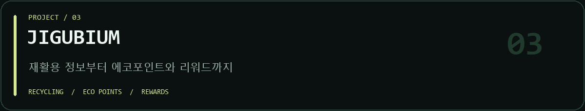

  

  <a href="#projects">Projects</a> ·
  <a href="#toolbox">Toolbox</a> ·
  <a href="https://github.com/ohnuj?tab=repositories">Repositories</a> ·
  <a href="mailto:jjh980225@gmail.com">Contact</a>

 

<h2 id="projects">Selected Projects</h2>

**내 역할** · 실시간 채팅·채팅방 / 영상·사용자 화면 / 신고·알림 / 저작권 관리

- WebSocket·STOMP 채팅과 참여자·초대·방장 위임·강퇴 구현
- 인증 복구, 반복 요청 제한, 연결·종료 흐름 보완

`Java` `Spring Boot` `React` `MySQL` `Redis` `WebSocket`

저장소 포크 및 시연 영상 공개 예정

 

**내 역할** · Gemini 개인화 추천 / 응답 검증 / 트랜잭션 / 추천 과정 추적

- 표본 수에 따른 Cold Start → Hybrid → Personalized 추천 로직 구현
- 일기·추천의 트랜잭션 저장, 장소 검색 연동 및 MongoDB 추적 로그 구현

`Spring Boot` `MySQL` `MongoDB` `Gemini API` `Kakao Local API`

**[Repository ↗](https://github.com/ohnuj/mood-and-move) · [시연 영상 ↗](https://youtu.be/KhvVEx4mxlc)**

 

**내 역할** · 팀장 / 화면·DB 설계 / 재활용 검색 / 포인트·리워드·관리자

- 재활용 정보 검색과 에코포인트 적립·사용·이력 관리 구현
- 리워드 교환·관리자 처리 및 팀 역할 분담·진행 상황 조율

`Java` `Spring MVC` `MyBatis` `MySQL` `Thymeleaf`

**[Repository ↗](https://github.com/ohnuj/jigubium) · [시연 영상 ↗](https://youtu.be/zqBimjOBDw8)**

 

<h2 id="toolbox">Toolbox</h2>

| Backend | Frontend | Data & Infra |
| :--- | :--- | :--- |
| Java · Spring Boot | React · JavaScript | MySQL · MongoDB |
| JPA · QueryDSL · MyBatis | HTML · CSS · Thymeleaf | Redis · Docker · AWS |
| Spring Security · STOMP | | Git · GitHub Actions |

**Learning now** · SQLD / FastAPI / LLM  
**Next up** · 개인 포트폴리오와 프로젝트 개발 기록 정리

 

---

  <b>LET’S BUILD SOMETHING.</b>  
  <a href="https://github.com/ohnuj">GitHub</a> ·
  <a href="mailto:jjh980225@gmail.com">Gmail</a> ·
  <a href="mailto:jjho980225@naver.com">Naver Mail</a>

