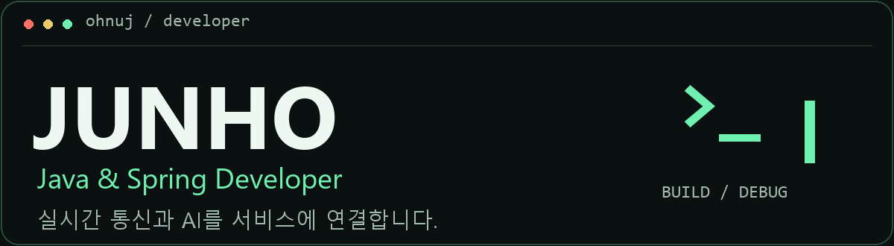
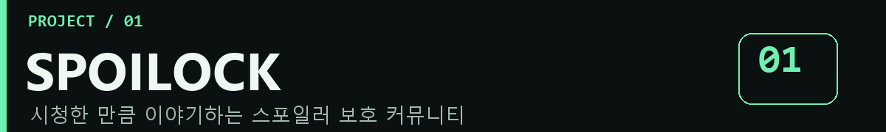
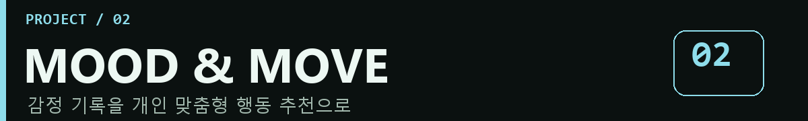
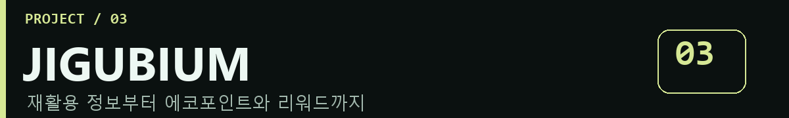

<p align="center">
  
</p>

<p align="center">
  <a href="#projects"><b>Projects</b></a> &nbsp; / &nbsp;
  <a href="#toolbox"><b>Toolbox</b></a> &nbsp; / &nbsp;
  <a href="https://github.com/ohnuj?tab=repositories"><b>Repositories</b></a> &nbsp; / &nbsp;
  <a href="mailto:jjh980225@gmail.com"><b>Contact</b></a>
</p>

<br>

<h2 id="projects">Selected Work</h2>

<!-- ====================================================== -->
<!-- PROJECT 01 · SPOILOCK                                  -->
<!-- ====================================================== -->



### SPOILOCK

**시청 진도 기반 AI 스포일러 보호 커뮤니티**

영상 시청, 실시간 채팅, 커뮤니티를 하나의 서비스로 연결했습니다.  
사용자의 시청 진도를 기준으로 아직 보지 않은 작품의 사건을 보호하고,  
실시간 소통과 개인화된 콘텐츠 경험을 제공하는 플랫폼입니다.

| Development | Team | My Role |
|:---:|:---:|:---:|
| 2026.10.19 — 11.16 | 3 Developers | Backend · Frontend |

<br>

#### 01 / What I Built

**실시간 채팅부터 영상·사용자 화면, 연결 안정화까지 구현했습니다.**

| Area | Implementation |
|:---|:---|
| **Real-time Chat** | WebSocket·STOMP 기반 메시지 송수신, 공개방·비밀방, 실시간 참여자 및 채팅 이벤트 처리 |
| **Room Management** | 초대코드, 사용자 초대, 방장 위임, 강퇴, 참여자 관리 및 권한별 UI 구성 |
| **Video & Contents** | 작품 상세, 회차별 영상 플레이어, 시청 화면 및 영상·자막 관리 기능 |
| **Social Experience** | 마이페이지, 팔로우, 사용자 활동 조회, 신고·초대·팔로우 알림 |
| **Live Updates** | 채팅·댓글 등 사용자 활동을 새로고침 없이 반영하는 실시간 화면 연동 |
| **Reliability** | 인증 상태 복구, 반복 요청 제한, WebSocket 연결·종료 및 재연결 처리 |

<br>

#### 02 / Engineering Challenges

**기능 구현에 그치지 않고 사용자 상태와 연결 흐름을 함께 고려했습니다.**

| Challenge | Approach |
|:---|:---|
| **실시간 연결 관리** | WebSocket 연결과 종료, 재연결 상황에서 클라이언트의 연결 및 구독 상태를 관리하도록 처리 |
| **채팅방 권한 처리** | 일반 참여자와 방장의 수행 가능 작업을 구분하고, 방장 위임·강퇴 등 상태 변경을 화면 흐름과 연결 |
| **인증 상태 복구** | 인증 상태에 따라 사용자 요청과 연결 흐름이 달라지는 부분을 점검하고 복구 로직 보완 |
| **사용자 경험 일관성** | 채팅, 팔로우, 알림, 댓글 등의 상태 변경이 관련 화면에 반영되도록 기능 연동 |

<br>

#### 03 / Service Architecture

<sub>아래 구성은 팀 전체의 서비스 아키텍처입니다.</sub>

```text
                     CLIENT
                  React · Vite
                       │
                       ▼
                 AWS ALB / Nginx
                       │
           ┌───────────┴───────────┐
           ▼                       ▼
      Spring Boot 01          Spring Boot 02
      REST / STOMP            REST / STOMP
           │                       │
           └───────────┬───────────┘
                       │
             ┌─────────┴─────────┐
             ▼                   ▼
           MySQL                Redis
       Service Data        Pub/Sub · Events
                                   │
                                   ▼
                             FastAPI Server
                             AI Spoiler Judge
                                   │
                            Gemini · ChromaDB
```

팀 프로젝트에서는 **AI의 사건 분석 결과와 사용자별 공개 정책을 분리**했습니다.

- **AI Analysis** — SRT·STT 기반 작품 사건 검색 및 Gemini 판정
- **Spoiler Policy** — 화자와 수신자의 시청 진도를 비교해 공개 여부 결정
- **Real-time Delivery** — Redis Pub/Sub을 통한 다중 서버 메시지 이벤트 공유
- **Infrastructure** — AWS EC2·S3·ALB 및 GitHub Actions 기반 배포 환경

<br>

#### 04 / Technology

`Java` `Spring Boot` `Spring Security` `JPA` `QueryDSL`  
`React` `WebSocket` `STOMP` `Redis` `MySQL` `AWS`

<p>
  <a href="https://github.com/ohnuj/spoilock">
    
  </a>
  <a href="https://youtu.be/z9cc1VkcjHE">
    
  </a>
</p>

<br>

---

<!-- ====================================================== -->
<!-- PROJECT 02 · MOOD & MOVE                               -->
<!-- ====================================================== -->

<a href="https://github.com/ohnuj/mood-and-move">
  
</a>

### Mood & Move

**AI 기반 감정 기록 및 개인 맞춤형 행동 추천 서비스**

사용자의 감정과 일기를 바탕으로 실천할 행동을 추천하고,  
행동 전후의 감정 변화를 다음 추천에 반영하는 서비스입니다.  
LLM 응답 검증과 개인화 점수 설계, 데이터 저장 일관성에 집중했습니다.

| Development | Team | My Role |
|:---:|:---:|:---:|
| 2026.09.29 — 10.16 | 3 Developers | Backend · AI Integration |

<br>

#### 01 / What I Built

**AI 추천 생성부터 개인화, 데이터 저장, 주변 장소 탐색까지 구현했습니다.**

| Area | Implementation |
|:---|:---|
| **AI Recommendation** | Gemini API를 이용해 감정·일기·선호 정보를 기반으로 행동 3개 추천 |
| **Prompt Engineering** | 사용자 의도, 취미·동행 선호, 개인화 통계 및 활동 다양성을 반영한 프롬프트 구성 |
| **Response Validation** | 행동 카테고리, 소요 시간, 중복 여부, 장소 속성 등 LLM 응답 유효성 검증 |
| **Personalization** | 행동 전후 감정 점수와 유효 재측정 표본을 이용한 카테고리별 개인화 점수 계산 |
| **Transaction** | 외부 API 호출과 DB 저장을 분리하고 일기·추천 데이터를 단일 트랜잭션으로 처리 |
| **Data Consistency** | 저장 조건 재확인, 사용자 행 잠금 및 실패 시 롤백 처리 |
| **Place Discovery** | Kakao Local API 기반 주변 장소 검색, 거리·카테고리 필터 및 캐시·재조회 구현 |
| **Observability** | MongoDB 기반 추천 생성 과정 및 처리 결과 추적 로그 기록 |

<br>

#### 02 / Personalization Strategy

**사용자의 데이터가 쌓이는 정도에 따라 추천 방식을 변경했습니다.**

| Valid Samples | Recommendation Mode | Strategy |
|:---:|:---|:---|
| **0 — 2** | `COLD START` | 현재 감정, 일기, 선호 정보를 중심으로 탐색 |
| **3 — 9** | `HYBRID` | 현재 상황과 초기 행동 효과를 함께 반영 |
| **10+** | `PERSONALIZED` | 누적된 카테고리별 행동 효과를 적극 활용 |

개인화 점수는 **평균 감정 변화량, 긍정 변화 비율, 유효 표본 수**를 사용합니다.

표본이 적을 때는 중립 점수인 50점에 가깝게 유지하고,  
유효한 재측정 기록이 쌓일수록 실제 행동 효과의 반영 비중을 높이도록 설계했습니다.

> LLM 모델 자체를 재학습한 것이 아니라,  
> 서버에서 계산한 개인화 통계를 다음 Gemini 요청의 입력 맥락으로 전달했습니다.

<br>

#### 03 / Transaction & Failure Handling

**추천 생성에 실패했을 때 일기만 저장되는 문제를 방지했습니다.**

```text
             USER REQUEST
                  │
                  ▼
          입력 상태 및 조건 확인
                  │
                  ▼
          Gemini API 호출
                  │
                  ▼
            LLM 응답 검증
                  │
          ┌───────┴───────┐
          │               │
        SUCCESS          FAILED
          │               │
          ▼               └── 저장 전 종료
     MySQL Transaction
          │
          ├── 사용자 행 잠금
          ├── 저장 조건 재확인
          ├── 일기 데이터 저장
          └── 추천 세션 및 행동 저장
          │
      ┌───┴────┐
      ▼        ▼
    COMMIT   ROLLBACK
```

| Design Point | Reason |
|:---|:---|
| **API / DB 분리** | 외부 LLM 응답 대기 동안 DB 트랜잭션을 유지하지 않도록 구성 |
| **조건 이중 검증** | API 호출 전과 저장 직전에 조건을 확인해 중복 요청 및 상태 변경에 대응 |
| **Atomic Persistence** | 일기와 추천 데이터가 일부만 저장되는 상황을 방지 |
| **Generation Logging** | 추천 생성 과정의 추적 정보를 MongoDB에 별도로 기록 |

<br>

#### 04 / Technology

`Java 21` `Spring Boot` `JPA` `MySQL` `MongoDB`  
`Gemini API` `Kakao Local API` `React` `Flyway`

<p>
  <a href="https://github.com/ohnuj/mood-and-move">
    
  </a>
  <a href="https://youtu.be/KhvVEx4mxlc">
    
  </a>
</p>

<br>

---

<!-- ====================================================== -->
<!-- PROJECT 03 · JIGUBIUM                                  -->
<!-- ====================================================== -->

<a href="https://github.com/ohnuj/jigubium">
  
</a>

### 지구비우기

**재활용 정보 탐색에서 친환경 실천까지 연결하는 생활형 플랫폼**

공공데이터 기반 재활용 정보 검색과 친환경 활동을  
에코포인트·리워드 시스템으로 연결한 웹 서비스입니다.  
팀장으로서 서비스 설계부터 주요 기능 구현, 기능 통합과 일정 조율을 담당했습니다.

| Development | Team | My Role |
|:---:|:---:|:---:|
| 2026.08.18 — 09.02 | 5 Developers | Team Leader · Full Stack |

<br>

#### 01 / What I Built

**서비스 설계와 포인트·리워드 시스템, 운영 기능을 중심으로 개발했습니다.**

| Area | Implementation |
|:---|:---|
| **Project Leadership** | 기능 범위 정의, 역할 분담, 일정 관리, 팀원별 개발 진행 상황 및 기능 통합 조율 |
| **Service Design** | 화면 흐름, ERD, 데이터베이스 구조 및 주요 도메인 간 관계 설계 |
| **Recycling Search** | 공공데이터 기반 재활용 품목 검색, 분류·배출 방법 및 주의사항 안내 |
| **Search Experience** | 관련 품목 및 자주 검색한 품목을 활용한 정보 탐색 흐름 구성 |
| **Eco Point** | 회원 활동에 따른 포인트 적립·차감 및 현재 보유 포인트 조회 |
| **Point Ledger** | 포인트 사용·적립 내역과 잔액 변동을 추적하는 이력 관리 구조 |
| **Reward Exchange** | 상품 조회, 교환 신청, 포인트 차감, 재고 감소 및 신청 내역 관리 |
| **Admin Dashboard** | 회원·게시글·미확인 건의·리워드 요청 등 주요 운영 현황 조회 |
| **Admin Operations** | 공지사항 CRUD, 건의 확인, 리워드 승인·거절 및 기준 데이터 관리 |
| **Team Collaboration** | 개발 기능 통합, 프로젝트 계획서·완료보고서 작성 및 최종 발표 |

<br>

#### 02 / Point & Reward Transaction

**포인트와 상품 재고, 교환 신청 내역을 하나의 처리 단위로 관리했습니다.**

```text
             REWARD EXCHANGE
                    │
                    ▼
               상품 선택
                    │
                    ▼
              교환 요청 접수
                    │
                    ▼
           @Transactional
                    │
          ┌─────────┴─────────┐
          ▼                   ▼
      보유 포인트 확인      재고 확인
          │                   │
          └─────────┬─────────┘
                    │
              교환 조건 검증
                    │
          ┌─────────┴─────────┐
          ▼                   ▼
       조건 충족             조건 미충족
          │                   │
          ▼                   └── 교환 중단
      재고 감소
          │
          ▼
      포인트 차감·이력 저장
          │
          ▼
      교환 신청 내역 저장
          │
          ▼
         COMMIT

       실패 시 ROLLBACK
```

| Design Point | Implementation |
|:---|:---|
| **Validation** | 상품 존재 여부, 보유 포인트, 교환 가능 재고 검증 |
| **Transaction Boundary** | 재고 감소·포인트 사용·교환 신청 정보를 하나의 트랜잭션으로 처리 |
| **Point History** | 적립·사용 내역을 별도 원장으로 관리해 변동 이력 추적 |
| **Reward Status** | 교환 신청 내역과 관리자 처리 상태 연결 |
| **Consistency** | 일부 작업만 반영되는 상태를 방지하기 위한 롤백 처리 |

<sub>
동시 요청에 대한 완전한 재고 경쟁 방지까지 검증했다는 의미는 아니며,
잠금·조건부 갱신과 동시성 테스트는 추가 개선 과제로 구분했습니다.
</sub>

<br>

#### 03 / Administration & Leadership

**사용자 기능뿐 아니라 운영자가 서비스를 관리하는 흐름까지 구성했습니다.**

| Management | Features |
|:---|:---|
| **Dashboard** | 회원 수, 게시글 수, 미확인 건의 및 처리 대기 리워드 현황 |
| **Community** | 공지사항 작성·수정·삭제, 사용자 건의 확인 |
| **Rewards** | 리워드 상품 관리, 사용자 교환 요청 승인·거절 |
| **Master Data** | 재활용 품목 및 수거함 위치 데이터 CRUD |
| **Project Delivery** | 역할 분담, 일정 조율, 기능 통합, 프로젝트 문서화 및 발표 |

팀 전체의 인프라에서는 HAProxy 기반 Web 요청 분산,  
Web·App 계층 이중화, Redis 로그인 세션 공유 및 MySQL 데이터 저장 구조를 사용했습니다.

<br>

#### 04 / Technology

`Java 17` `Spring MVC` `MyBatis` `MySQL`  
`Thymeleaf` `JavaScript` `Redis` `Kakao Map API`

<p>
  <a href="https://github.com/ohnuj/jigubium">
    
  </a>
  <a href="https://youtu.be/zqBimjOBDw8">
    
  </a>
</p>

<br>

---

<!-- ====================================================== -->
<!-- TOOLBOX                                               -->
<!-- ====================================================== -->

<h2 id="toolbox">Toolbox</h2>

**Technologies & Engineering Experience**

<sub>
프로젝트에서 사용한 기술과 구현 과정에서 다룬 주요 영역을 정리했습니다.
</sub>

<br>

### 01 / Backend Development

<p>
  
  
  
</p>

`Spring Security` `JPA` `QueryDSL` `MyBatis` `REST API` `WebSocket`

| Focus | Experience |
|:---|:---|
| **Application** | REST API 설계, 서비스 로직, Controller·Service·Repository 계층 분리 |
| **Persistence** | JPA·QueryDSL·MyBatis 기반 데이터 조회 및 저장 |
| **Reliability** | 트랜잭션, 입력값 검증, 실패 및 롤백 처리 |
| **Real-time** | WebSocket·STOMP 연결 및 실시간 이벤트 처리 |

<br>

### 02 / Frontend Development

<p>
  
  
  
  
</p>

`Thymeleaf` `Vite` `Recharts` `React Router`

| Focus | Experience |
|:---|:---|
| **UI Architecture** | React 컴포넌트 구성, 화면 상태와 사용자 이벤트 처리 |
| **Integration** | REST API·WebSocket 기반 서버 데이터 연동 |
| **Interface** | 반응형 레이아웃, 사용자 흐름, 동적 화면 구성 |
| **Visualization** | 통계 데이터 차트 및 사용자별 데이터 표현 |

<br>

### 03 / Database & Messaging

<p>
  
  
  
</p>

| Technology | Experience |
|:---|:---|
| **MySQL** | 관계형 데이터 모델링, 트랜잭션, 이력·상태 관리 |
| **MongoDB** | AI 추천 생성 과정 및 결과 추적 로그 |
| **Redis** | 캐싱, 세션 공유, Pub/Sub 메시징 |

<br>

### 04 / Cloud & DevOps

<p>
  
  
  
</p>

`EC2` `S3` `ALB` `SSM` `Nginx` `Linux` `Git` `GitHub`

| Focus | Project Experience |
|:---|:---|
| **Cloud** | AWS 기반 WEB·WAS 구성 및 서비스 운영 환경 경험 |
| **Deployment** | GitHub Actions 기반 빌드 및 배포 자동화 구성 경험 |
| **Infrastructure** | 로드 밸런싱, 서버 역할 분리, 다중 서버 아키텍처 |
| **Collaboration** | Git 브랜치 관리, 팀 개발 및 기능 통합 |

<br>

### 05 / AI & External Integrations

<p>
  
  
  
</p>

`FastAPI` `ChromaDB` `RAG` `Prompt Engineering`

| Focus | Experience |
|:---|:---|
| **LLM Integration** | Gemini API 요청 구성, 응답 검증 및 실패 처리 |
| **Personalization** | 사용자 데이터 기반 추천 점수 및 모드 설계 |
| **External APIs** | Kakao Local API 기반 장소 검색 및 데이터 필터링 |
| **AI Architecture** | FastAPI·ChromaDB·RAG 기반 AI 판정 서비스와의 통합 프로젝트 경험 |

<br>

---

<!-- ====================================================== -->
<!-- CURRENTLY EXPLORING                                   -->
<!-- ====================================================== -->

<h2>Currently Exploring</h2>

| Now | Next |
|:---|:---|
| `SQLD` · `FastAPI` · `LLM / RAG` | 개인 포트폴리오 · 프로젝트 개선 · 기술 기록 |

<br>

---

<!-- ====================================================== -->
<!-- CONTACT                                               -->
<!-- ====================================================== -->

<p align="center">
  <b>LET'S BUILD SOMETHING.</b>
</p>

<p align="center">
  사용자 경험을 구현하고,<br>
  데이터의 일관성과 서비스의 안정성을 고민합니다.
</p>

<p align="center">
  <a href="https://github.com/ohnuj"><b>GitHub</b></a> &nbsp; · &nbsp;
  <a href="mailto:jjh980225@gmail.com"><b>Gmail</b></a> &nbsp; · &nbsp;
  <a href="mailto:jjho980225@naver.com"><b>Naver Mail</b></a>
</p>

